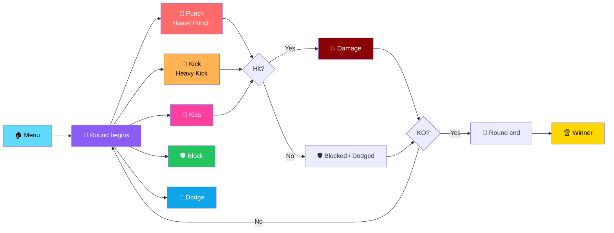
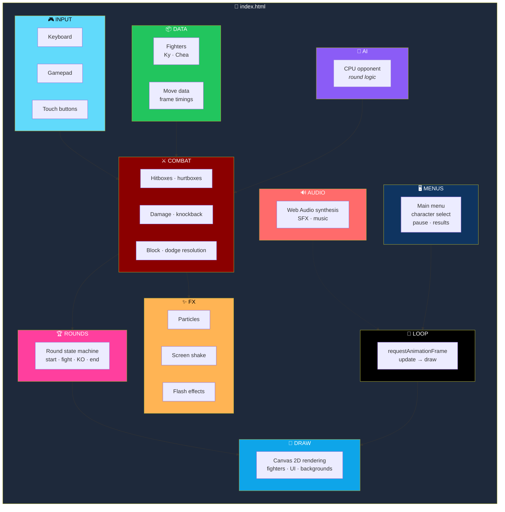

# 💋 KISS & FIGHT: LOVE IS WAR

<div align="center">


**A 2D arcade fighting game — Ky vs Chea.**

*Love is war. And war has combos.*

[🚀 Run Locally](#-run-locally) • [🎮 Controls](#-controls) • [🌐 Deploy](#-deploy-to-the-web) • [📱 Package for Mobile](#-package-for-mobile-later) • [🏗️ Code Layout](#-code-layout-inside-indexhtml)

</div>

---

## 📖 Overview

**KISS & FIGHT: LOVE IS WAR** is a **2D arcade fighting game** in a **single, dependency-free HTML file**.

### Core Idea

> **Two fighters. One file. Zero dependencies.**
>
> Ky and Chea settle it the only way arcade fighters know how — with punches, kicks, kisses, and blocks.

### The Fight Flow



---

## 🚀 Run Locally

### Option 1 — Just Open It

**Double-click `index.html`** in any modern browser.

### Option 2 — Serve the Folder

```bash
npx serve .
# or
python3 -m http.server 8080   # then open http://localhost:8080
```

---

## 🎮 Controls

### ⌨️ Player 1 — Keyboard

<div align="center">

| Key | Action |
|:---:|--------|
| **A / D** | Move |
| **W** | Jump |
| **J** | Punch |
| **K** | Heavy Punch |
| **L** | Kick |
| **U** | Heavy Kick |
| **I** | Kiss |
| **S** | Block |
| **Shift** | Dodge |

</div>

### ⌨️ Player 2 — Keyboard

<div align="center">

| Key | Action |
|:---:|--------|
| **Arrows** | Move |
| **Z / X / C / V** | Attacks |
| **B** | Kiss |
| **N** | Dodge |

</div>

### 🎮 Player 1 — Gamepad

<div align="center">

| Input | Action |
|:-----:|--------|
| **Stick / D-pad** | Move |
| **A** | Jump |
| **X / Y / B / RT** | Attacks |
| **RB** | Kiss |
| **LB** | Block |
| **LT** | Dodge |

</div>

### 📱 Mobile

**On-screen buttons** *(landscape orientation)*.

### ⏸️ Pause

**Esc** pauses.

---

## 🌐 Deploy to the Web

> **Upload `index.html` to any static host.**
>
> **No build step.**

### Supported Hosts

<div align="center">

| Host | How |
|:----:|-----|
| **Netlify Drop** | Drag and drop |
| **Vercel** | `vercel deploy` |
| **GitHub Pages** | Push and enable Pages |
| **Cloudflare Pages** | Connect the repo |

</div>

---

## 📱 Package for Mobile Later

**Wrap the folder with [Capacitor](https://capacitorjs.com/):**

```bash
npm init -y
npm i @capacitor/core @capacitor/cli
npx cap init kissfight com.example.kissfight --web-dir=.
npx cap add android
npx cap add ios
npx cap sync
```

---

## 🏗️ Code Layout *(Inside `index.html`)*

> **Everything lives inside one HTML file — organized into clearly separated sections.**



### 📂 Section Guide

<div align="center">

| Section | Responsibility |
|:-------:|---------------|
| **🔊 AUDIO** | Web Audio synthesis for sound effects and music — **no audio files** |
| **🎮 INPUT** | Unified input handling for keyboard, gamepad, and touch |
| **📦 DATA** | Fighter rosters *(Ky, Chea)*, move lists, and frame timings |
| **✨ FX** | Particles, screen shake, and flash effects |
| **⚔️ COMBAT** | Hitbox and hurtbox resolution, damage, knockback, block and dodge logic |
| **🤖 AI** | CPU opponent behavior and round logic |
| **🏆 ROUNDS** | Round state machine — start, fight, KO, end |
| **🎨 DRAW** | Canvas 2D rendering of fighters, UI, and backgrounds |
| **🖥️ MENUS** | Main menu, character select, pause, and results screens |
| **🔄 LOOP** | The `requestAnimationFrame` update-and-draw loop |

</div>

### Design Principles

<div align="center">

| Principle | Implementation |
|-----------|---------------|
| **📄 One file, zero dependencies** | The whole game is `index.html` — **portable, shareable, works from `file://`** |
| **🎮 Three input paths** | Keyboard, gamepad, and touch all feed **one input layer** — P1 plays on any device |
| **🎨 Canvas 2D for everything** | Fighters, UI, backgrounds, and FX are **drawn in code** — **no image assets** |
| **🔊 Audio is synthesized** | SFX and music via **Web Audio API** — **no audio files** |
| **⚔️ Combat is deterministic** | Hitboxes, hurtboxes, and frame timings drive outcomes — **no animation-based hit detection** |
| **🎭 Two fighters, one engine** | Ky and Chea share the same combat core — **adding a fighter is a data change, not an engine change** |
| **📱 Landscape mobile ready** | On-screen buttons in landscape — **and easy to wrap with Capacitor later** |
| **🚫 No build step** | Upload the file and it runs |

</div>

---

## 🗺️ Roadmap

### ✅ Current

- [x] Single-file, dependency-free HTML game
- [x] Canvas 2D rendering for fighters, UI, and backgrounds
- [x] Two fighters — Ky and Chea
- [x] Punch, heavy punch, kick, heavy kick, kiss, block, and dodge
- [x] Player 1 keyboard controls — A/D/W/J/K/L/U/I/S/Shift
- [x] Player 2 keyboard controls — Arrows, Z/X/C/V, B, N
- [x] Player 1 gamepad support — stick/d-pad, A, X/Y/B/RT, RB, LB, LT
- [x] On-screen touch buttons for mobile in landscape
- [x] Pause via Esc
- [x] Web Audio synthesized SFX and music
- [x] Particle effects, screen shake, and flash effects
- [x] Hitbox and hurtbox-based combat resolution
- [x] Damage, knockback, block, and dodge logic
- [x] CPU opponent AI and round logic
- [x] Round state machine — start, fight, KO, end
- [x] Main menu, character select, pause, and results screens
- [x] Runs from `file://` or any static server
- [x] Deployable to any static host — Netlify Drop, Vercel, GitHub Pages, Cloudflare Pages
- [x] Capacitor-ready for Android and iOS packaging

### 🔜 Future Ideas

- [ ] **Additional fighters** — the engine supports data-driven rosters
- [ ] **Training mode** — infinite health, frame data display
- [ ] **Combo counter and damage scaling**
- [ ] **Special moves and supers** — beyond the current basic attacks
- [ ] **Stage variety** — multiple backgrounds
- [ ] **Replay and highlight capture**
- [ ] **Local multiplayer match settings** — rounds, timer, health
- [ ] **Online multiplayer** — would require a real backend or WebRTC
- [ ] **Native mobile builds** — via the Capacitor path documented above
- [ ] **Accessibility options** — remappable keys, adjustable hitbox display

---

## 🤝 Contributing

Contributions are welcome. Please:

1. Fork the repository
2. **Keep it single-file** — no external build step, no bundler
3. **Keep it dependency-free** — no frameworks, no assets
4. **Keep input paths unified** — new controls must reach the same input layer
5. **Keep combat deterministic** — never couple hit detection to animation timing
6. **Keep fighters data-driven** — adding a fighter should not require engine changes
7. **Preserve touch parity** — every attack must have an on-screen equivalent
8. **Preserve the Capacitor path** — the folder must remain wrappable without changes
9. Test in a browser before submitting
10. Submit a Pull Request

### Guidelines

- **Never add a required external dependency**
- **Never require a build step** — `index.html` and nothing else
- **Never ship audio or image assets** — everything is synthesized or drawn in code
- **Never break `file://` compatibility**
- **Never present a stub as a feature**

---

## 📜 License

MIT — see [LICENSE](LICENSE) for details.

---

## 🙏 Acknowledgments

- **Canvas 2D** — for making a full fighting game possible in one file
- **Web Audio API** — for a game with zero audio files
- **Every arcade fighter that ever made you mash buttons with a friend** — this one's for you

---

<div align="center">

### 💋 KISS. FIGHT. LOVE. WAR.

**A 2D arcade fighting game — Ky vs Chea.**

**One file. Zero dependencies. Love is war.**

<br>

⭐ If KISS & FIGHT delivered a KO, consider giving it a star.

<br>

[⬆ Back to Top](#-kiss--fight-love-is-war)

</div>
